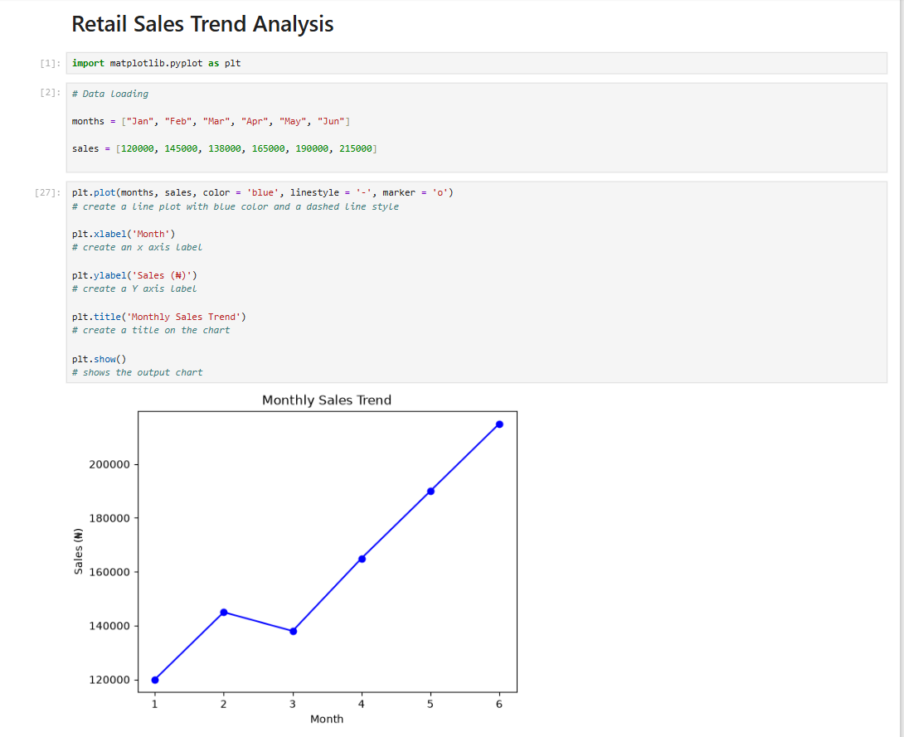
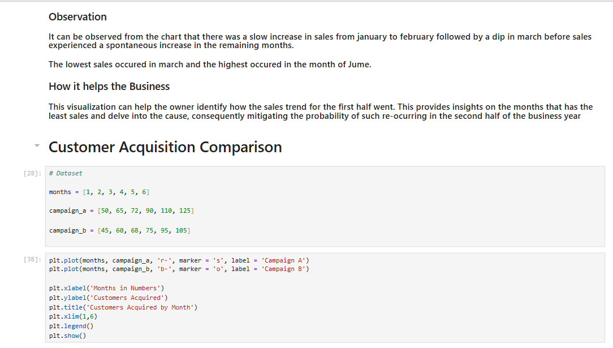
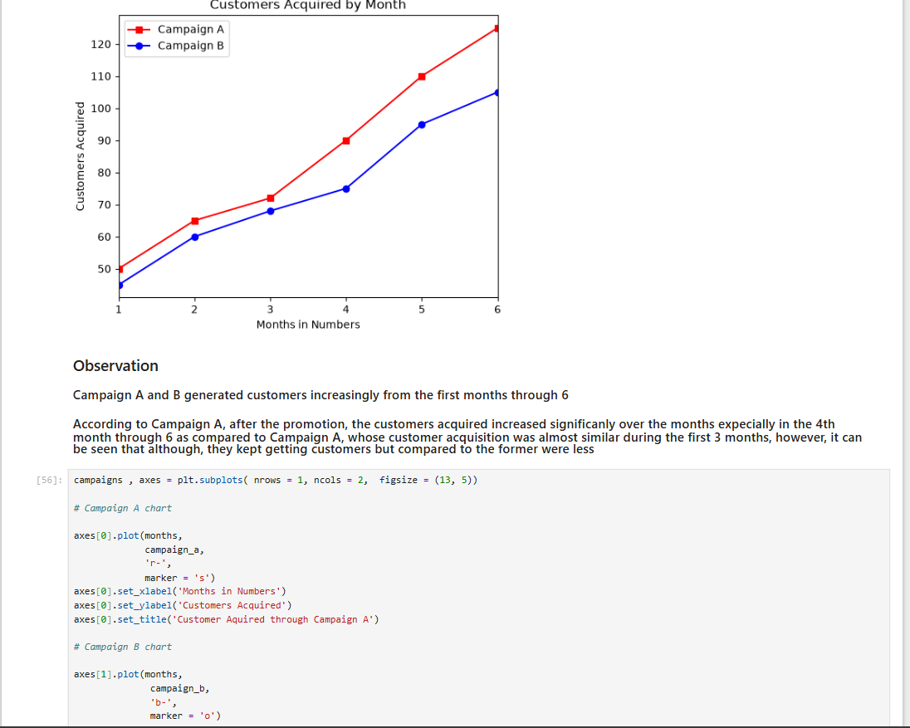
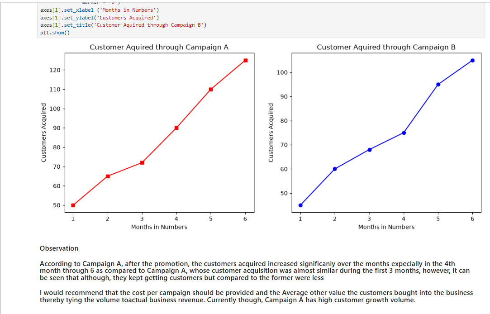
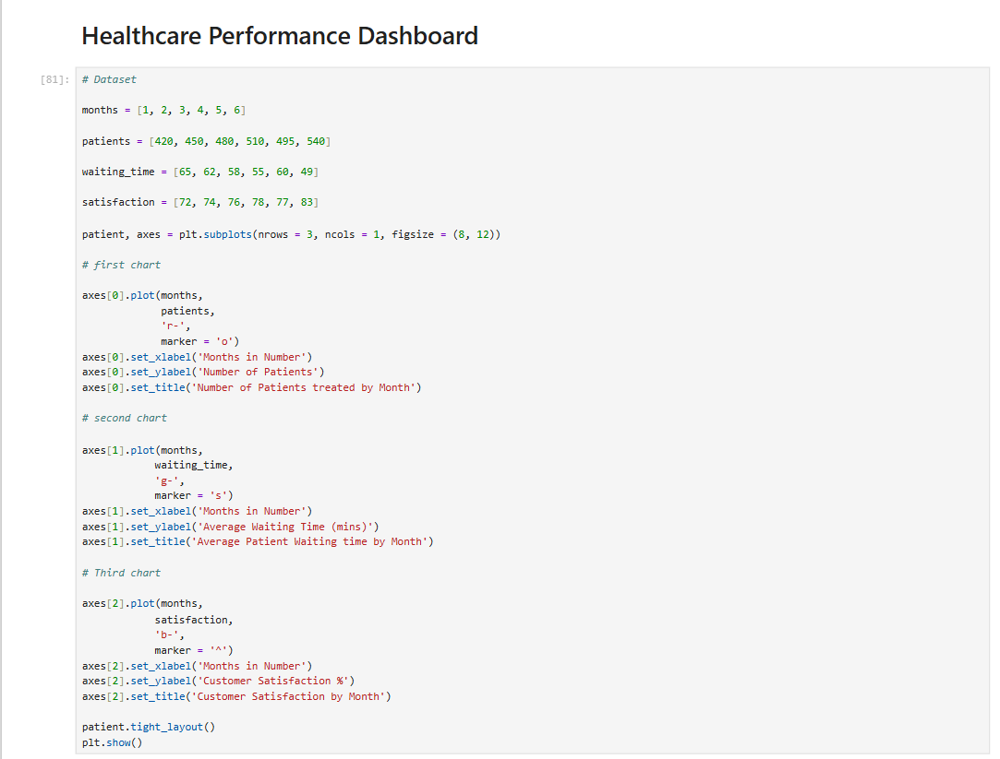
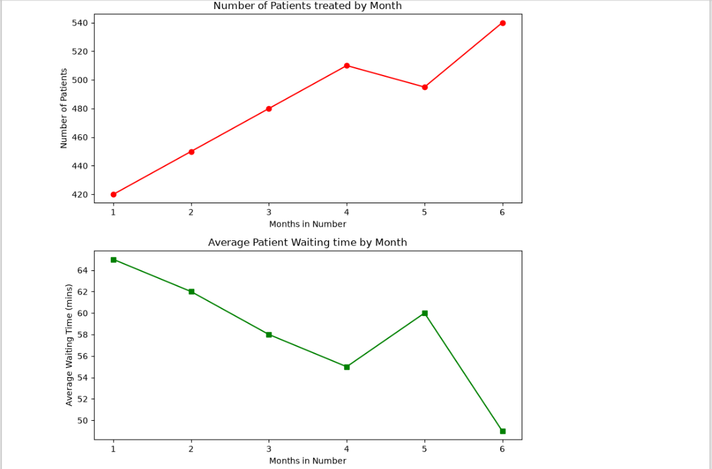
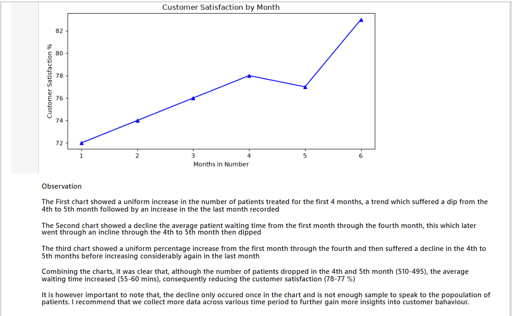
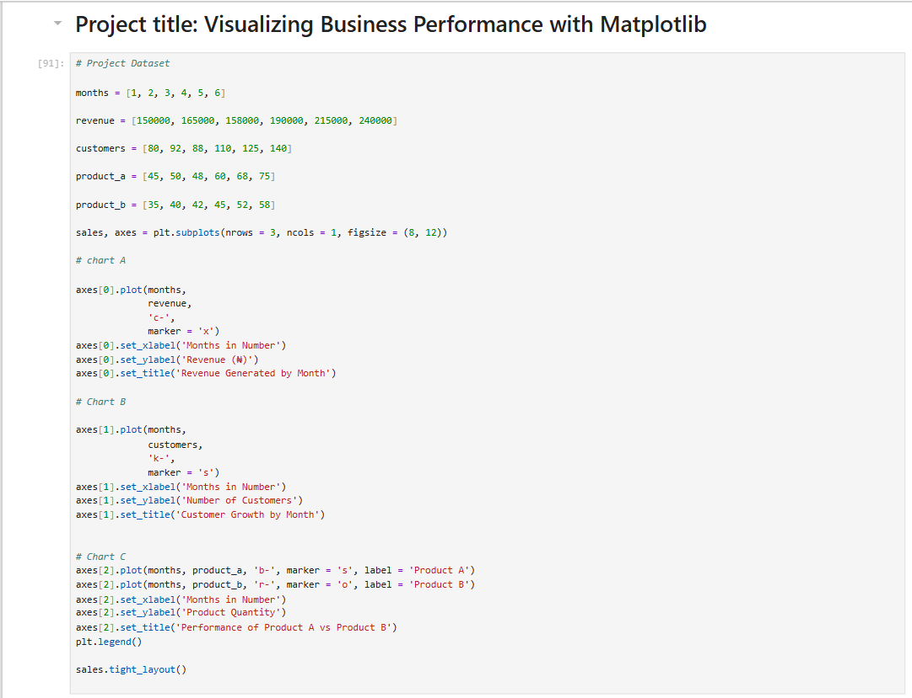
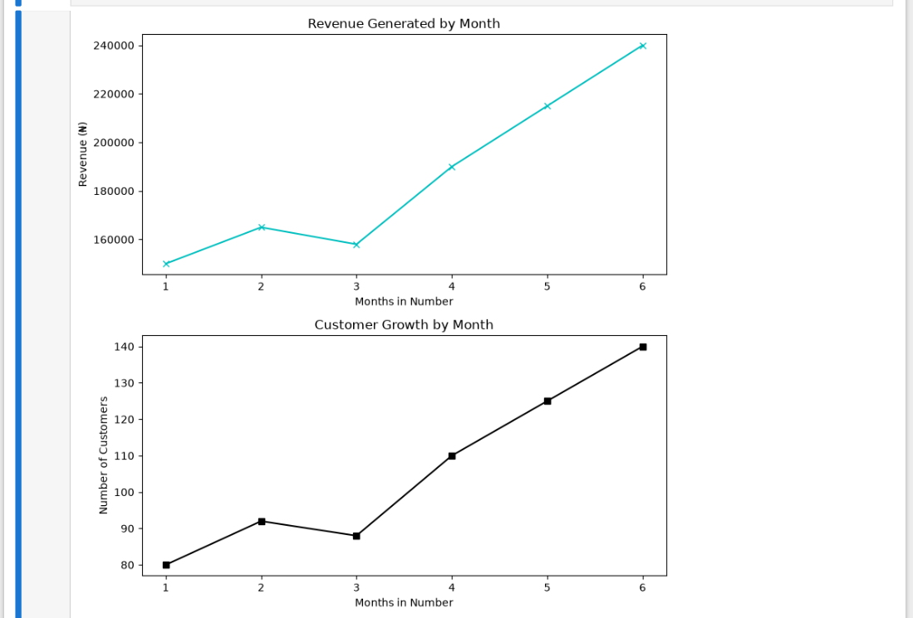
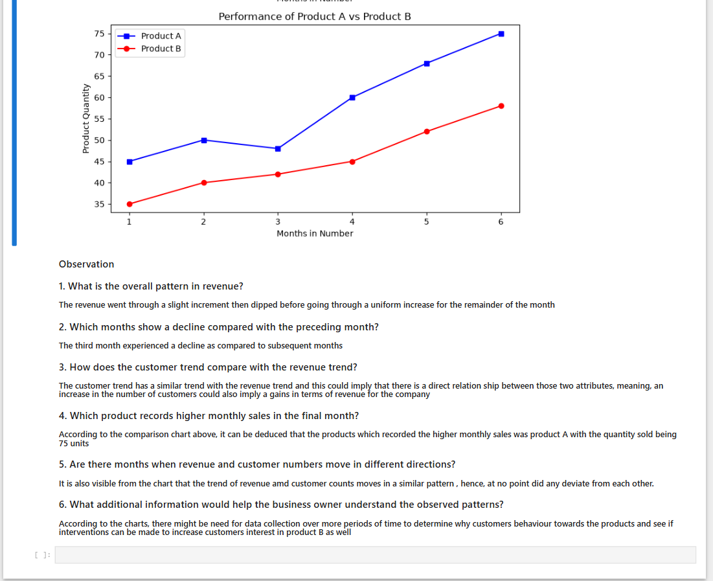

# Visualizing Business and Operational Performance with Matplotlib

## Introduction
Data visualization serves as one of the most critical components of modern data analytics, acting as the fundamental bridge between raw, unstructured numbers and strategic executive decision-making. In this comprehensive project, we explore the immense capabilities of Python and the Matplotlib library to build insightful, clear, and publication-quality visual representations across multiple domains, including retail sales trajectories, digital marketing campaign efficiencies, and operational healthcare service metrics. By transforming complex numerical records into intuitive graphical formats, this project empowers business stakeholders, analysts, and project managers to instantly comprehend performance health, identify underlying anomalies, and formulate data-driven strategies that optimize both revenue generation and operational workflows.

---

## Problem Statement
In contemporary business environments, organizations across retail, healthcare, and marketing sectors are frequently inundated with massive volumes of raw operational data stored in tabular formats, spreadsheets, and databases. Stakeholders often struggle to extract actionable meaning from columns of raw digits when analyzing sales growth patterns, comparing marketing channels, or tracking service delivery efficiency. Without the implementation of robust data visualization techniques, critical operational insights—such as unexpected seasonal sales dips, underperforming marketing campaigns, and escalating customer wait times—remain completely obscured. This lack of clear visibility routinely results in delayed administrative responses, misallocated resources, and suboptimal strategic decision-making that can negatively impact overall business growth and client satisfaction.

---

## Importance
The strategic application of professional data visualization is paramount for modern organizations seeking a competitive advantage through data-driven practices. By translating complex data sets into graphical narratives, decision-makers can achieve the following objectives:

* **Enhanced Comprehension:** Business owners and executives can instantly interpret complex multi-month sales trends and revenue distributions without getting bogged down by raw data tables.
* **Targeted Optimization:** Marketing departments can visually evaluate and compare the performance and customer acquisition velocities of competing promotional campaigns to allocate advertising budgets more efficiently.
* **Operational Excellence:** Service managers can closely monitor crucial operational metrics—such as patient volumes, service waiting times, and satisfaction percentages—allowing them to streamline workflows, eliminate bottlenecks, and significantly improve end-user experiences.
* **Proactive Problem Solving:** Visual tracking allows organizations to spot irregular performance drops early, facilitating timely corrective interventions long before minor issues compound into major financial or operational failures.

---

## Features
This project incorporates several robust analytical and visual features designed to maximize data clarity and presentation value:
* **Dynamic Time-Series Tracking:** Employs precise line graphs with customized markers to illustrate chronological performance trajectories over multi-month periods.
* **Multi-Campaign Comparative Frameworks:** Utilizes multi-line plotting configurations to monitor and contrast competing marketing campaign performances side-by-side within a unified axis space.
* **Structured Multi-Panel Dashboards:** Leverages advanced grid layouts and subplot grids (`plt.subplots`) to present multiple related operational parameters simultaneously, ensuring cohesive analysis without visual clutter.
* **High Customization Standards:** Implements fully customized axis labels, descriptive chart titles, distinct color palettes, clear gridlines, data point markers, and descriptive legends to maximize aesthetic appeal and readability.

---

## 5. Python Work Flow
The architectural workflow for developing these visualizations in Python follows a systematic, industry-standard data analytics pipeline:
1. **Environment Setup and Library Import:** Importing the core visualization engine, specifically `matplotlib.pyplot`, to establish the graphical canvas environment.
2. **Data Structure Definition:** Organizing raw business and operational metrics into structured Python lists, arrays, or data collections representing temporal intervals and quantitative values.
3. **Canvas and Axis Initialization:** Defining figure dimensions, layout structures, and single or multi-panel subplot grids to accommodate the target visualizations.
4. **Plot Styling and Configuration:** Configuring visual aesthetics, including line styles, color codes, marker shapes, axis boundaries, and legends.
5. **Data Mapping & Rendering:** Passing the structured data variables into Matplotlib's plotting functions (`plt.plot()`, `axes[i].plot()`) and rendering the completed graphical outputs using `plt.show()`.

---

## 6. Project Workthrough

### Retail Sales Trend Analysis
This section analyzes monthly sales performance over the first half of the year to identify growth patterns and low-performing periods.

```python
import matplotlib.pyplot as plt

# Data loading for monthly retail sales
months = ["Jan", "Feb", "Mar", "Apr", "May", "Jun"]
sales = [120000, 145000, 138000, 165000, 190000, 215000]

# Generate line plot
plt.plot(months, sales, color='blue', linestyle='-', marker='o')
plt.xlabel('Month')
plt.ylabel('Sales (₦)')
plt.title('Monthly Sales Trend')
plt.show()
```
### Customer Acquisition Comparison
This section compares the growth performance of two different marketing campaigns (Campaign A and Campaign B) across six months.

```python
import matplotlib.pyplot as plt

# Dataset for campaign comparison
months_num = [1, 2, 3, 4, 5, 6]
campaign_a = [50, 65, 72, 90, 110, 125]
campaign_b = [45, 60, 68, 75, 95, 105]

# Plotting multiple campaigns on a single axis
plt.plot(months_num, campaign_a, 'r-', marker='s', label='Campaign A')
plt.plot(months_num, campaign_b, 'b-', marker='o', label='Campaign B')

plt.xlabel('Months in Numbers')
plt.ylabel('Customers Acquired')
plt.title('Customers Acquired by Month')
plt.xlim(1, 6)
plt.legend()
plt.show()
```
### Healthcare Performance Dashboard
This section utilizes a multi-row subplot layout to analyze patient volume, average waiting times, and patient satisfaction percentages simultaneously.

```python
import matplotlib.pyplot as plt

# Operational datasets
months = [1, 2, 3, 4, 5, 6]
patients = [420, 450, 480, 510, 495, 540]
waiting_time = [65, 62, 58, 55, 60, 49]
satisfaction = [72, 74, 76, 78, 77, 83]

# Create a multi-row subplot layout
patient, axes = plt.subplots(nrows=3, ncols=1, figsize=(8, 12))

# Subplot 1: Patient volume chart
axes[0].plot(months, patients, 'r-', marker='o')
axes[0].set_xlabel('Months in Number')
axes[0].set_ylabel('Number of Patients')
axes[0].set_title('Number of Patients treated by Month')

# Subplot 2: Waiting time chart
axes[1].plot(months, waiting_time, 'g-', marker='s')
axes[1].set_xlabel('Months in Number')
axes[1].set_ylabel('Average Waiting Time (mins)')
axes[1].set_title('Average Patient Waiting time by Month')

# Subplot 3: Satisfaction chart
axes[2].plot(months, satisfaction, 'b-', marker='^')
axes[2].set_xlabel('Months in Number')
axes[2].set_ylabel('Customer Satisfaction %')
axes[2].set_title('Customer Satisfaction by Month')

patient.tight_layout()
plt.show()

```
### Revenue and Product Performance Analysis
This section analyzes overall revenue patterns alongside customer growth metrics and evaluates comparative performance trends between Product A and Product B.

```python
# Project Dataset
months = [1, 2, 3, 4, 5, 6]
revenue = [150000, 165000, 158000, 190000, 215000, 240000]
customers = [80, 92, 88, 110, 125, 140]
product_a = [45, 50, 48, 60, 68, 75]
product_b = [35, 40, 42, 45, 52, 58]

sales, axes = plt.subplots(nrows=3, ncols=1, figsize=(8, 12))

# Chart A: Revenue Generated
axes[0].plot(months, revenue, 'c-', marker='x')
axes[0].set_xlabel('Months in Number')
axes[0].set_ylabel('Revenue (₦)')
axes[0].set_title('Revenue Generated by Month')

# Chart B: Customer Growth
axes[1].plot(months, customers, 'k-', marker='s')
axes[1].set_xlabel('Months in Number')
axes[1].set_ylabel('Number of Customers')
axes[1].set_title('Customer Growth by Month')

# Chart C: Product A vs Product B Performance
axes[2].plot(months, product_a, 'b-', marker='s', label='Product A')
axes[2].plot(months, product_b, 'r-', marker='o', label='Product B')
axes[2].set_xlabel('Months in Number')
axes[2].set_ylabel('Product Quantity')
axes[2].set_title('Performance of Product A vs Product B')
axes[2].legend()

sales.tight_layout()
plt.show()

```

### Screenshots











### Result

Through the structured execution of this project, the following technical and analytical results were successfully achieved:

* Developed clean, highly readable, and professionally styled line graphs and multi-panel subplot dashboards using Python and Matplotlib.
* Successfully translated raw tracking metrics into structured visual assets that clearly map out performance trajectories over temporal intervals.
* Provided a repeatable, scalable code framework that can be easily adapted for automated reporting dashboards across diverse enterprise sectors.

### Findings
Detailed analysis of the generated visualizations yielded several vital business insights:

* **Retail Sales Dynamics:** Sales experienced a modest upward movement from January to February, followed by a noticeable temporary contraction in March. However, the business demonstrated robust recovery and exponential growth through the remainder of the period, with June peaking as the highest performing sales month.

* **Marketing Campaign Efficacy:** Comparative evaluation revealed that Campaign A consistently outperformed Campaign B in total customer acquisition volume, exhibiting steep growth acceleration during months 4 through 6.

* **Operational Correlations:** Operational tracking demonstrated that increases in service waiting times directly correlate with temporary dips in client satisfaction scores, proving that workflow efficiency is directly tied to end-user perception.

### Improvements
To further enhance the depth, robustness, and commercial value of this project, several future improvements are recommended:

* **Expanded Historical Scope:** Integrate multi-year historical data sets to capture broader macroeconomic seasonality, cyclical market shifts, and long-term business growth patterns.

* **Advanced Financial Modeling:** Incorporate campaign expenditure and cost-per-acquisition (CPA) metrics alongside raw user counts to calculate true Return on Investment (ROI) for marketing strategies.

* **Interactive Dashboard Migration:** Transition static Matplotlib scripts into interactive web-based dashboards using frameworks like Streamlit or Plotly Dash for real-time stakeholder monitoring.

### Author
OSENI, Latifat Omolara.
